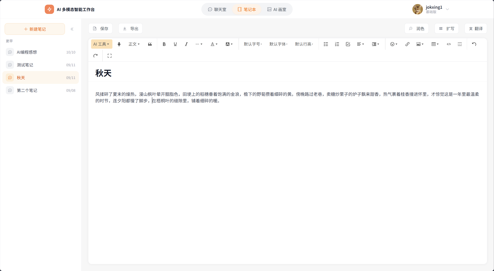
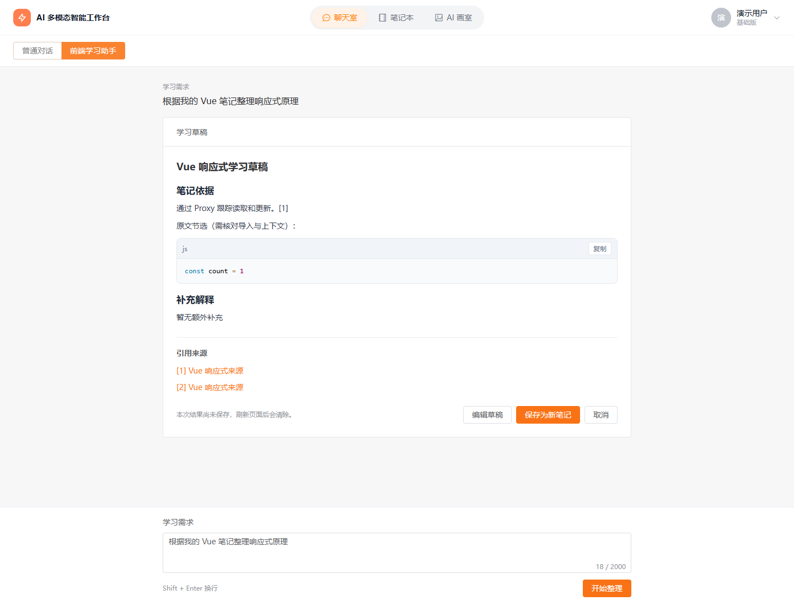
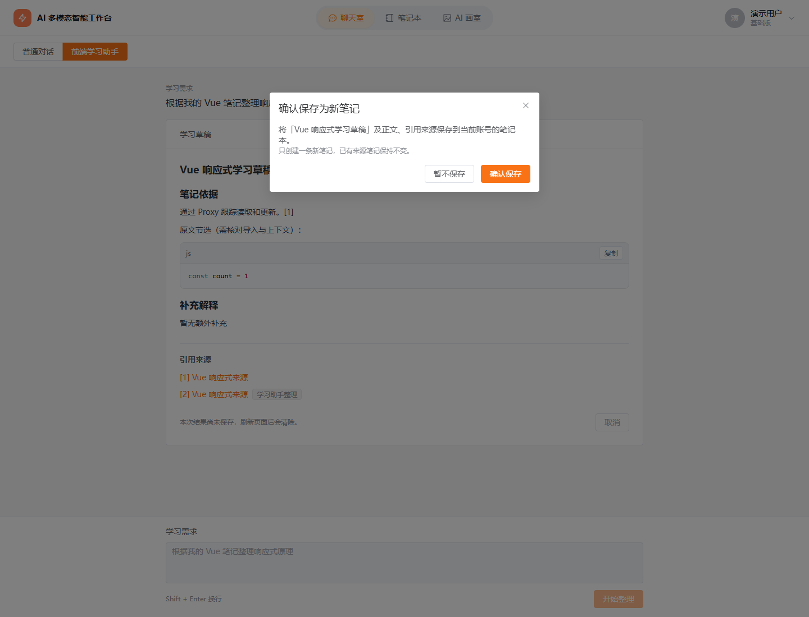
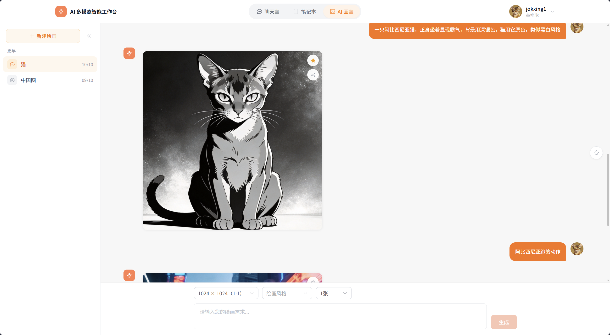
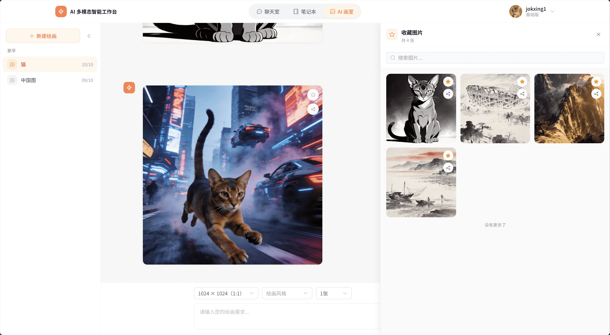

# AI 多模态工作台

集流式对话、富文本笔记、笔记整理 Agent、图像生成与语音交互于一体的全栈应用，支持从内容交流、选区润色到资料整理与笔记保存。

技术栈：Vue 3、JavaScript、Element Plus、wangEditor、Pinia、Node.js / Express、Prisma / MySQL、SSE、WebSocket、Railway。

## 功能与实现亮点

- **对话与内容管理**：流式输出、历史会话与收藏，支持停止生成、超时处理及异常反馈。
- **富文本笔记**：支持编辑器选区润色与确认替换；结合防抖、串行保存及提交快照，防止迟到响应覆盖新草稿。
- **笔记整理 Agent**：按需检索和读取当前用户笔记，生成带来源引用的可编辑草稿，经用户确认后保存为新笔记，保留原始资料。
- **多模态交互**：集成图像生成、语音识别与朗读，支持生成图片持久化及朗读暂停、继续。
- **数据与成本管理**：服务端检查资源归属，配合富文本清洗、调用额度、共享预算及并发限制保护用户数据和调用成本。

## 界面展示

### 富文本笔记与选区润色

### 笔记整理 Agent

检索已有笔记，整理带引用的草稿，支持编辑后确认保存。

### 图像生成

### 收藏管理

## 技术导览

[阅读关键实现：流式交互、编辑保存、Agent 与数据保护 →](docs/technical-guide.md)

本项目使用 Cursor、Codex 辅助开发，本人承担需求梳理、前端实现与代码审核、接口联调、部署及人工操作检查。

本仓库用于展示界面与技术方案，业务源码保存在私有仓库。涉及源码交流或同类开发需求，可通过原联系渠道沟通。

[返回 GitHub 主页](https://github.com/jokxing)
